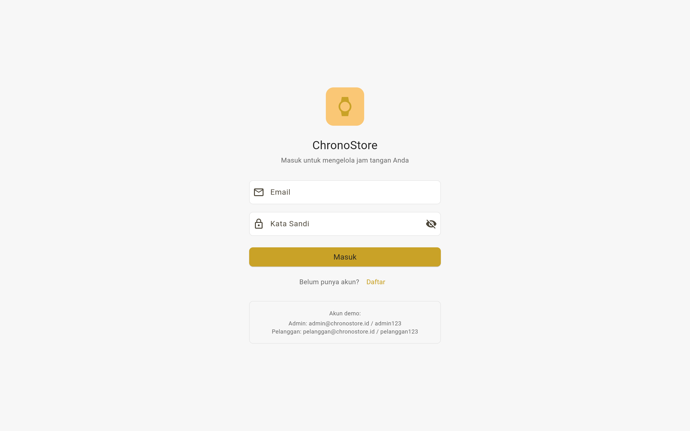
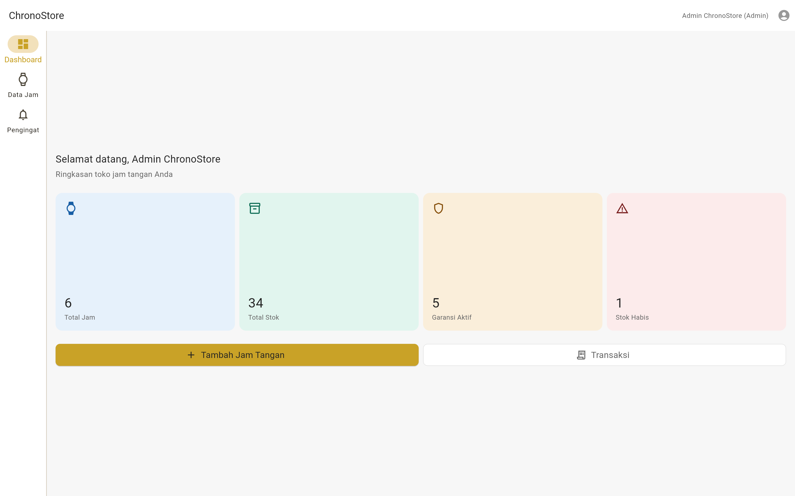

# ChronoStore

Sistem Informasi Manajemen Toko Jam Tangan — aplikasi untuk mengelola stok, nomor seri, garansi, dan riwayat servis jam tangan. Proyek individu MK Mobile and Web Application Development, Kelas A1, Semester Ganjil 2026/2027.

## Identitas

- **Nama:** Maheswari Shafa Helga
- **NIM:** 23.01.55.0005
- **Kelas:** A1
- **Mata Kuliah:** Mobile and Web Application Development
- **Pengampu:** Jeffri Alfa Razaq & Dwi Budi Santoso

## Deskripsi Singkat

ChronoStore adalah sistem informasi yang membantu pemilik/admin toko jam tangan mengelola data produk, stok, nomor seri unik, riwayat servis, dan pengingat garansi. Aplikasi dibangun dengan Flutter dan berjalan di mobile (Android) maupun web (Chrome), dengan navigasi responsif (BottomNavigationBar untuk mobile, NavigationRail untuk web/tablet).

**Masalah yang diselesaikan:**
1. Pencatatan stok dan nomor seri yang manual dan rentan duplikasi
2. Informasi tipe mesin dan spesifikasi yang tidak terorganisir
3. Riwayat servis dan pengingat garansi yang tidak terkelola

**Pengguna utama:** Admin/pemilik toko jam tangan (CRUD produk, riwayat servis, pengingat). Pengguna sekunder: Pelanggan (katalog, pesan).

## Tautan

- **Desain Figma (Wireframe Minggu 4):** https://www.figma.com/design/shafa-chronostore-wireframe
- **Repository GitHub:** [https://github.com/shafahelga/jam_tangan](https://github.com/senanas/UTS_MOBILE-AND-WEB-APPLICATION-DEVELOPMENT_23.01.55.0005)
- **Proposal UTS:** [docs/PROPOSAL_UTS_CHRONOSTORE.md](docs/PROPOSAL_UTS_CHRONOSTORE.md)

## Cara Menjalankan

```bash
# Pastikan Flutter SDK terpasang dan terdeteksi
flutter doctor

# Masuk ke folder project
cd jam_tangan

# Install dependencies
flutter pub get

# Jalankan di Chrome
flutter run -d chrome
```

### Akun Demo

| Role | Email | Password |
|------|-------|----------|
| Admin | admin@chronostore.id | admin123 |
| Pelanggan | pelanggan@chronostore.id | pelanggan123 |

## Fitur Utama (MVP)

| No | Fitur | Prioritas | Status |
|----|-------|-----------|--------|
| 1 | Login & Register dengan validasi email/password | Must | ✅ |
| 2 | Dashboard ringkasan (total jam, stok, garansi aktif, stok habis) | Should | ✅ |
| 3 | CRUD jam tangan dengan validasi nomor seri unik | Must | ✅ |
| 4 | Detail jam tangan dengan info garansi | Should | ✅ |
| 5 | Riwayat servis per jam tangan (catat & tampilkan) | Must | ✅ |
| 6 | Pengingat garansi & servis (jatuh tempo <= 7 hari) | Should | ✅ |
| 7 | Katalog jam tangan untuk pelanggan dengan filter & pencarian | Must | ✅ |
| 8 | Transaksi/pesanan pelanggan | Should | ✅ |
| 9 | Integrasi Firebase (Auth + Firestore) | Won't (UAS) | Rencana |
| 10 | Pembayaran online | Won't | — |
| 11 | Notifikasi WhatsApp | Won't | — |

## Tech Stack

| Komponen | Teknologi |
|----------|-----------|
| Framework | Flutter 3.47.7 (channel stable) |
| Bahasa | Dart 3.13.5 |
| State management | Provider (ChangeNotifier) |
| Target platform | Web (Chrome) — mobile responsive |
| Desain UI | Figma |
| Version control | Git + GitHub |
| Backend (rencana UAS) | Firebase Spark — Firestore, Authentication, Hosting |

## Rancangan Database Firestore (Rencana UAS)

4 collection utama:
- **users** — uid, name, email, role (admin/customer)
- **watches** — name, brand, model, movementType, price, stock, serialNumber (unique), warrantyStart, warrantyEnd
- **service_records** — watchId, serviceDate, serviceType, description, cost, nextServiceDate
- **transactions** — watchId, watchName, quantity, unitPrice, totalPrice, customerName, userId, status

Detail lengkap: [docs/PROPOSAL_UTS_CHRONOSTORE.md](docs/PROPOSAL_UTS_CHRONOSTORE.md)

## Struktur Project

```
jam_tangan/
├── lib/
│   ├── main.dart                    # Entry point + MultiProvider
│   ├── app/
│   │   ├── theme.dart               # Tema (emas #C9A227, Material 3)
│   │   └── constants.dart           # Konstanta & named routes
│   ├── models/                      # Watch, UserAccount, ServiceRecord, Transaction
│   ├── repositories/                # Repository pattern (mock_data → Firestore)
│   ├── providers/                   # AuthProvider, WatchProvider, ServiceProvider, TransactionProvider
│   ├── screens/                     # 11 halaman
│   │   ├── login_screen.dart        # Form login + validasi
│   │   ├── register_screen.dart     # Form registrasi
│   │   ├── main_shell.dart          # Navigasi antar 3 halaman utama
│   │   ├── dashboard_screen.dart    # Ringkasan admin / katalog pelanggan
│   │   ├── watch_list_screen.dart   # Daftar/katalog + filter + search
│   │   ├── watch_form_screen.dart   # Form tambah/edit (8 field, 4 jenis input)
│   │   ├── watch_detail_screen.dart # Detail + riwayat servis
│   │   ├── reminder_screen.dart     # Pengingat garansi & servis
│   │   ├── service_history_screen.dart
│   │   ├── transaction_screen.dart
│   │   └── transaction_form_screen.dart
│   ├── widgets/                     # AppScaffold, EmptyState, WatchCard, StatusBadge
│   ├── services/                    # ValidationService (7 validator)
│   └── utils/                       # DateUtils, IdGenerator
├── docs/
│   ├── PROPOSAL_UTS_CHRONOSTORE.md  # Proposal UTS lengkap
│   ├── PANDUAN_UTS_CHRONOSTORE.md   # Panduan video presentasi
│   ├── NARASI_VIDEO_UTS.md          # Teks narasi video UTS
│   ├── WORKSHEET_MINGGU_5_SHAFA.md
│   ├── WORKSHEET_MINGGU_6_SHAFA.md
│   ├── WORKSHEET_MINGGU_7_SHAFA.md
│   ├── screenshot-login.png
│   └── screenshot-dashboard.png
├── uts-video/                       # Video UTS (Remotion + edge-tts)
├── test/
│   └── widget_test.dart             # Test halaman login
└── pubspec.yaml
```

## Screenshot

**Halaman Login**



**Dashboard Admin — tampilan web (NavigationRail aktif pada lebar >= 600px)**



## Video UTS

Video presentasi (masalah, target pengguna, dan scope) dibuat dengan
Remotion + narasi edge-tts, durasi 3:23.

- Sumber & cara render: [`uts-video/README.md`](uts-video/README.md)
- Teks narasi: [`docs/NARASI_VIDEO_UTS.md`](docs/NARASI_VIDEO_UTS.md)

## Style Guide

| Elemen | Warna |
|--------|-------|
| Primer (emas) | #C9A227 |
| Teks utama | #222222 |
| Latar | #F7F7F7 |
| Status: berhasil | #2E7D32 |
| Status: menunggu | #ED8B00 |
| Status: galat | #C62828 |

| Elemen | Ukuran |
|--------|--------|
| Judul | 24px |
| Subjudul | 18px |
| Isi | 16px |
| Caption | 14px |
| Tinggi tombol | 48px |
| Spacing | kelipatan 8px (4, 8, 16, 24, 32) |

## Worksheet Minggu 1-7

| Minggu | Fokus | File |
|--------|-------|------|
| 1 | Ide & problem statement | (docx, dikumpulkan terpisah) |
| 2 | Persona & user stories | (docx, dikumpulkan terpisah) |
| 3 | User flow & sitemap | (docx, dikumpulkan terpisah) |
| 4 | Wireframe Figma | (docx + Figma) |
| 5 | Setup Flutter + GitHub | docs/WORKSHEET_MINGGU_5_SHAFA.md |
| 6 | Widget, layout, navigasi | docs/WORKSHEET_MINGGU_6_SHAFA.md |
| 7 | Form, validasi, state | docs/WORKSHEET_MINGGU_7_SHAFA.md |
